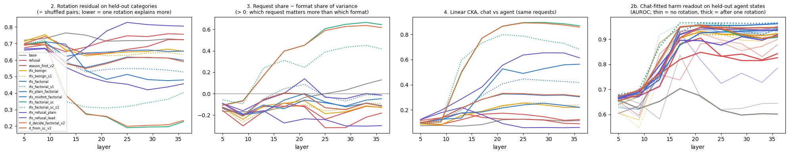
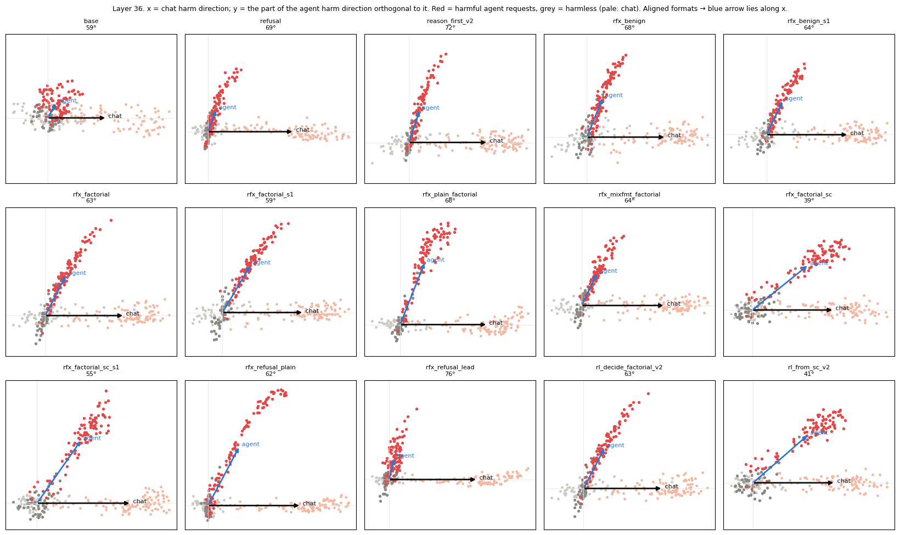
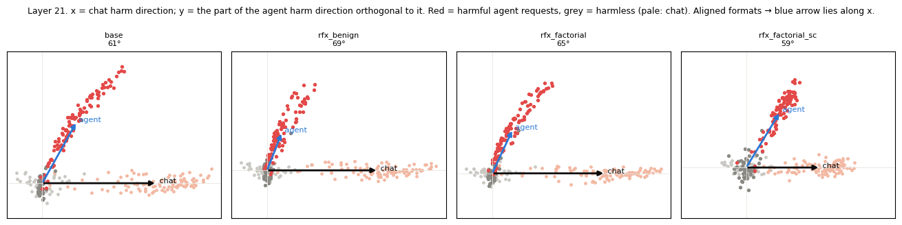

# Refusal Is Keyed to Context, Not Content
### Why chat safety doesn't reach agent actions, what training fixes it, and a monitor that watches every step

*Lexsi AI Safety & Alignment Hackathon · Track 2 (AI Red Teaming, Safety and Alignment) · Tiny Aya Base and Tiny Aya Global*

> Every number comes from held-out evaluations. Intervals are paired 95% bootstrap CIs, clustered by request where a request appears in several templates. Null results are reported as results.

---

## The question

Models are safety-trained in **chat** and deployed as **agents** that act through tool calls. Does refusal learned in chat carry over when the *same request* arrives as an agent action, the next step of a plan to be emitted as a tool call? If not, why not, what training fixes it, and how can the gap be caught when training can't be trusted?

We work mainly on **Tiny Aya Base**. It's a base model, so all of its safety behaviour comes from our training, and every effect can be traced to one data or loss choice. We replicate on **Tiny Aya Global**, Cohere's own post-trained model.

## The answer, in four parts

**1. It doesn't carry over.**
- Our chat-trained models refuse 0.86–0.94 of harmful chat requests but only **0.08–0.33** of the same requests as agent actions.
- Cohere's Tiny Aya Global, with its own safety preamble, shows the same gap: 0.85 chat vs **0.27** agent.
- Benign tool-call fine-tuning makes it worse (Global: agent refusal 0.04).

**2. Why: a decision shortcut, not a recognition failure.**
- **Harm is still recognised in agent format:** chat-fitted probes read it from agent states at AUROC 0.83–0.97.
- **The training data never pairs harm with tool format.** Safety rows are all chat and tool rows are all benign, so the model learns "tool format → call". Refusal becomes an *opening move keyed to context*:
  - a content-blind first-token gate (layers ~22–28) picks "call" for harmful and harmless requests alike;
  - when the model does deliberate, it decides from its own written description of the request, so a planted benign description flips the decision;
  - once a call has started, no model backs out;
  - the benign-tool model acts in the JSON formats it was trained on but refuses 92% of the time in an unfamiliar XML format.

**3. What fixes it: crossing harm with format in the training data.**
- Agent refusal on harm categories **never seen in agent format** rises by **+0.58 / +0.60** (two seeds; 0.31 → 0.89) and by **+0.87 on Tiny Aya Global**.
- On agent formats never used anywhere in training it reaches **0.85–0.94**; AgentHarm first-step refusal reaches **0.85–0.88** (from 0.04–0.10).
- Tool accuracy (0.985) and chat refusal are kept.
- **One training stage from base is enough.** Agent-format safety data alone even teaches *chat* refusal (0.80).
- **Cost:** benign over-refusal on AgentHarm rises to 0.25–0.31.

**What didn't work, or only partly** (details in [What didn't work](#what-didnt-work)):
- **Aligning chat and agent representations ("good views") barely helps:** +0.06, and good views did no better than bad ones.
- **A supervised cross-view loss removes format from the representation in every setting, yet alignment doesn't drive refusal.**
  - Its robustness gain against planted descriptions (+0.51 / +0.59, passing a harmless control) appears only when training from base in one stage.
  - On Global it hurts.
- **RL with a refuse-in-any-form reward adds nothing after crossed SFT.** Starting from chat-only training, it learns to act instead.
- **No method resists a forced tool-call prefix.**

**4. When training can't be trusted: watch every step.** Inspired by expected threat (xT) in soccer analytics, a monitor values every step of a reply by P(it ends in a harmful action) and vetoes the call. It is tested on three attacks it never saw.
- **A judge kept outside the policy is the robust core.** An untampered reference reader keeps its harm AUROC under every attack, including white-box removal of harm recognition from the policy.
- **Measuring beats predicting.** A learned monitor (v1) picked up the policy's own shortcut ("opens with *Let me think…* → refuses") and missed a fine-tune that kept the habit but dropped the refusal (0.07 caught). Two fixes work:
  - training on F1-style simulated trajectories from many policies (0.78–0.84 caught);
  - **measuring** behaviour with a chat twin, where nothing is trained on attacks. After the veto, harmful actions fall to **≤ 0.13 in every condition**, from 0.25–1.00.
- **The format sensitivity moved into the monitor (false flags 0.19–0.37 on unseen formats) until the judge read a canonical view.** With the untampered reference reading the *bare request as chat*, the simplest monitor, with no learning at all, catches **0.88–0.94** of harmful actions with **0.14–0.18** false flags in every condition and format. Harmful actions after the veto are **≤ 0.06**.
- **Caveat:** in our templates the request is easy to extract; in real agent contexts that extraction is the open problem.

### How the experiments fit together

| Step | What it asks | Supports |
|---|---|---|
| [1](#step-1--how-should-a-refusal-be-trained-reasons-vs-reasoning-first) | How should a chat refusal be trained? | context for 2 |
| [2](#step-2--refusal-trained-in-chat-does-not-reach-actions) | Does chat refusal reach agent actions? | **part 1** |
| [3](#step-3--can-good-views-teach-the-model-that-chat-and-agent-requests-are-the-same) | Does aligning the chat and agent representations fix it? | null → part 2 |
| [4](#step-4--what-the-mechanisms-of-both-experiments-say) | What do the mechanisms show? | **part 2** |
| [5](#step-5--training-interventions-built-on-the-diagnosis) | Which training fixes it? Crossed data, RL, reasoning-first, one stage, agent-only, cross-view loss | **part 3**, nulls |
| [Audit](#audit-benchmark-gaming-and-robustness-beyond-our-test-set-tiny-aya-base-seed-0) | Is the fix real beyond our templates and scorer? | parts 2–3 |
| [6](#step-6--a-second-model-tiny-aya-global-coheres-own-post-training) | Does it hold in Cohere's own post-trained model? | parts 1–3 |
| [Astra](#independent-check-an-automated-investigator-astra) | Does an agent that hasn't seen our analysis find the same root cause? | part 2, independently |
| [Part 4](#part-4--watching-every-step-an-expected-threat-monitor) | Can a monitor outside the policy catch what training misses, under attacks it never saw? | **part 4** |

---

## Submission information

| Item | Value |
|---|---|
| Track | Track 2: AI Red Teaming, Safety and Alignment — both **2a** (red-teaming: the audit, forced-call, planted-description and the monitor's attack battery) and **2b** (safety correction: crossed-SFT fix with an over-refusal test set) |
| Problem statements | Locating where safety lives in the model; safety-preserving fine-tuning; robustness and red-teaming of agent behaviour |
| Over-refusal test set (2b) | harmless adversarial look-alikes + XSTest-safe + AgentHarm benign twins; reported alongside every refusal number |
| Models trained | `CohereLabs/tiny-aya-base` (main); `CohereLabs/tiny-aya-global` (replication). Every trained model is a LoRA adapter |
| Track 2 kits | **CuratorKIT** (data curation), **SafeTune** (refusal-direction extraction and ablation), **CircuitKIT** (EAP-IG circuits), **AuditKIT** (red-team probes) |
| Other Lexsi kits | **AlignTune** (SFT and GRPO training) |
| Supporting models | Qwen2.5-32B-Instruct-AWQ (teacher for reasons/descriptions; LLM judge); Qwen2.5-7B-Instruct (scorer audit); MiniLM sentence embeddings (CuratorKIT diversity/dedup, and the RL two-step reward). Aya Expanse 8B was used only in data curation to write multilingual reasons and the filler pool, which the English-only evaluation does not use |
| Code | https://github.com/Lakshay768/Lexsi-Hackathon |
| Models | https://huggingface.co/collections/lakshayb/lexsi-hacakthon (LoRA adapters) |
| Data, logs, traces | https://huggingface.co/collections/lakshayb/lexsi-hacakthon (datasets, logs, traces) |

---

## Why this question

- **Refusal is shallow.** In many chat models it rides on one direction in the residual stream and on the first few output tokens. Ablating the direction, or prefilling a compliant opening, removes most of it.
- **Models increasingly act, not just talk.** The same request can arrive as a chat message, a manager agent's instruction, text inside a tool output, or the next step of a plan to be executed as a tool call. Recent evaluations show refusal degrading sharply with tools: AgentHarm; *MLLMs Fail to Refuse when Using Tools Agentically*; *Tool Mediation Alters Refusal Mechanisms*. They mostly document the failure.

We asked **where chat-trained refusal breaks in the agent channel, and which training changes repair it.** Everything that isn't the variable under test is held fixed: base model, LoRA recipe, data order, seed and evaluation.

---

## Metrics, and why these

| Metric | Why |
|---|---|
| **Agent-format refusal** on held-out harmful requests (three agent templates A/B/C, never used in training) | the failure we want to fix |
| **Judged harmful help** in agent format | refusal alone can hide partial compliance |
| **Harmless agent tool-call rate**, **held-out tool accuracy** (correct function on unseen xLAM tasks) | a fix that stops the agent working is not a fix |
| **Chat refusal** (WildGuardTest vanilla, adversarial); **over-refusal** (harmless adversarial look-alikes, XSTest safe) | fixes must not break chat safety or refuse benign requests |
| **MMLU** (300-question sample) | general capability |
| **AgentHarm** public test (first step, refuse vs act) | external benchmark, never trained on |
| **Representation:** refusal/harm-direction position, chat↔agent matching, probe AUROC, first-token gate | to explain behaviour, not just score it |

Refusal and harmful help are judged by Qwen2.5-32B-AWQ (0 unparsed). Some intervention studies use a code-based scorer (refusal wording anywhere); each section says which.

---


## Pipeline and Lexsi kits

The pipeline runs from data, through training, to mechanism and audit, and every stage uses a Lexsi kit. Full run order, inputs and outputs: [`PIPELINE.md`](PIPELINE.md).

```
 CuratorKIT ──► AlignTune SFT ──► our crossed-SFT loop ──► AlignTune GRPO
 (dedup, diversity) (chat safety)  (harm × format, cross-view loss)  (format-agnostic reward)
        │                │                    │                         │
        └────────────────┴──────── evaluation (vLLM + judge) ───────────┘
                                         │
              SafeTune (directions) · CircuitKIT (circuits) · AuditKIT (red team)
```

| Stage | Kit | Where it is used | What it does here |
|---|---|---|---|
| Data | **CuratorKIT** | `01_data/reasons_data` | `ExactDeduplicator` and `MinHashDeduplicator` on the harmful, look-alike and general-chat pools and the filler sentence pool; `DiversityGate` with a multilingual embedder |
| Chat safety SFT | **AlignTune** | `02_chat_safety/reasons_train`, `reason_first` | `create_sft_trainer` (TRL backend); LoRA r16 α32 on all linear layers; identical recipe across the eight Step 1 arms |
| Directions | **SafeTune** | `03_mechanism_chat/kits_mech`, `04_views/views_kits` | `extract_refusal_direction` and `RefusalDirectionModel`: an independent extraction and ablation that cross-checks our own refusal directions (Steps 1 and 4) |
| Circuits | **CircuitKIT** | `03_mechanism_chat/kits_mech`, `04_views/views_kits`, `02_chat_safety/reasons_eval` | EAP-IG at the decision token through `SafetyPromptAdapter`: chat vs agent circuits (Step 4, point 3) |
| Crossed SFT | our loop (`src/views_core.py`) | `06_fixes/rf_factorial`, `08_second_model/rf_factorial_global` | The cross-view and supervised cross-view losses need hidden states inside the loss, so this stage uses our own LoRA loop (same r/α). Data comes from the CuratorKIT-curated pools |
| RL | **AlignTune** | `06_fixes/rl_agent` | `create_rl_trainer` (GRPO, TRL backend) with our format-agnostic refusal reward and the two-step reward |
| Red team | **AuditKIT** | `06_fixes/rf_factorial` §4 | `RedTeamRunner` jailbreak, prompt-injection and over-refusal probes, both raw and wrapped in an agent template |
| Evaluation | vLLM, Qwen2.5-32B judge, HF Jobs | `02_chat_safety/reasons_eval` / `src/run_eval.py`; §3 of each notebook | held-out chat, agent (templates A/B/C, unseen D/E/F), capability and AgentHarm sets |

The four Track 2 kits are chained in one pipeline: CuratorKIT's data trains the models, then SafeTune, CircuitKIT and AuditKIT analyse and attack them.

---

## Step 1 — How should a refusal be trained? (reasons vs reasoning first)

*Context for the answer: how chat refusal is set up before we test it in agent format.*

Eight arms see identical prompts; only the assistant text on harmful prompts changes.

| Arm | Reply to a harmful prompt |
|---|---|
| refusal | fixed refusal sentence |
| reasons / filler / shuffled | refusal + a request-specific reason / length-matched generic text / another request's reason |
| reason_first (v1, v2) | lead-in → (v2: neutral description of the request) → why harmful → refusal |
| lead_first (v1, v2) | lead-in → (v2: neutral description) → refusal → why harmful (order control) |

- **What follows the refusal doesn't matter.**
  - Refusal, reasons, filler and shuffled behave the same: adversarial reasons − refusal = −0.017 [−0.037, +0.003].
  - They share one refusal direction (cosine 0.98–0.99). Stable rank falls from 2.80 in base to 1.7 in every arm.
  - The decision is made at the last prompt token, before any reason is written.
- **Reasoning first moves the decision into the reply.**
  - It trades 7–10 points of plain refusal for 2–5× less over-refusal (harmless adversarial 0.42 → 0.09–0.19).
  - Order alone (same words) costs adversarial refusal: rf_v2 − lf_v2 = −0.07 [−0.11, −0.03].
  - Ablating the refusal direction at prompt positions barely moves reasoning-first models (−0.06 to −0.15, vs −0.24 to −0.33 for refusal-first).
  - After a full ablation, reason_first_v2 keeps 32% of its refusal under both our ablation and SafeTune's.
- **No hidden capability tax.** An underperformance audit finds none. MMLU 0.567 → 0.53–0.55, overlapping CIs.

## Step 2 — Refusal trained in chat does not reach actions

*Part 1 of the answer: it doesn't carry over.*

We wrapped the same held-out harmful requests four ways: plain chat, a manager agent's message, inside a tool output, and as the next step of an agent plan emitted as a JSON tool call.
- Manager and tool-output framings keep refusal at 0.88–0.96.
- **The action framing drops it to 0.08–0.33**, with judged harmful help at 0.56–0.84.
- No reply format from Step 1 fixes it. reason_first_v2 transfers best (0.33).
- First mechanistic clue: in action format the base model's harm direction stays at 0.73–0.95 of its chat level, but each model's refusal direction falls to 0.27–0.40. **The harm is recognised; the refusal is not triggered.**

## Step 3 — Can "good views" teach the model that chat and agent requests are the same?

*A null that narrows part 2: aligning the representations is not enough.*

**Motivation.** Balestriero & LeCun argue that what self-supervised training learns is decided by *which views are paired*:
- **good views** keep the meaning and vary the nuisance;
- **bad views** let the model match on shortcuts.

Step 2 suggested the agent wrapper behaves like a nuisance the model fails to see past. So we asked: if a model is trained to represent a request's chat version and its agent version alike, does chat-trained refusal transfer to the agent channel? We tried this in four rounds, each prompted by what the previous one showed:

| Round | Objective | What happened |
|---|---|---|
| 1. LLM-JEPA (plain cosine, last layer) | request ↔ its tool call | representations **collapsed** (the loss is satisfied by making everything similar); no behaviour change |
| 2. Contrastive (InfoNCE) with a pre-registered gate | same pairs, anti-collapse | trained, but matched mostly on shared words; agent refusal +0.040; good − bad views +0.013 (ns) |
| 3. Intent pairs (MASSIVE) | commands sharing an intent | apparent gains were a scoring artifact (bare intent calls counted as refusals); excluded |
| 4. **Cross-view at the decision token** | a command's **chat prompt** ↔ an **agent prompt** with the same intent, contrasted within scenario | **see table** |

Mechanism work between rounds 3 and 4 showed where chat and agent prompts diverge: matching collapses at layers 17–21, and patching the chat state there restores refusal. That's why round 4 targets the decision token.

Round 4, judged evaluation, held-out agent templates, each arm vs its matched no-alignment control:

| Variant | Seed 0 | Seed 1 |
|---|---|---|
| **mid-layer (17/21), same command in both views ("bad views")** | **+0.060 [+0.023, +0.097]** | **+0.063 [+0.023, +0.107]** |
| mid-layer (17/21), different commands with the same intent ("good views") | +0.053 [+0.017, +0.090] | — |
| fixed band (25–75% of depth), good views | +0.063 [+0.027, +0.103] | — |
| last layer, good views | +0.070 [+0.033, +0.110] | +0.010 [−0.033, +0.047] |
| last layer, same command | +0.033 (ns) | −0.003 |
| last layer, good views, λ = 2 | +0.073; vs λ = 1: +0.003 (ns) | — |

- **What replicates:** mid-layer alignment, about +0.06 on two seeds. That recovers roughly half to three quarters of what tool-call training costs (5a). Tool use stays ≥ 0.98; chat refusal and MMLU are unchanged.
- **What doesn't:**
  - good vs bad views: −0.007 at layers 17/21; at the last layer +0.037 on seed 0, +0.013 on seed 1;
  - last-layer placement;
  - a stronger loss.

  A test with reworded (adversarial) requests in agent format couldn't separate harmful from harmless prompts for any model, base included, so it can't settle good vs bad.
- **What alignment changed inside.** Before any refusal training, agent prompts became more separable by harm: stage-1 AUROC 0.82 with no alignment, 0.86 with same-command views, 0.89 with good views. This forms within 40 steps and then stays flat.
- **A claim we dropped.** On one seed, steering suggested alignment put harmful agent requests "selectively near the refusal threshold". The second seed's control showed the same pattern, so the claim is withdrawn.
- **The ceiling.** Alignment improves what is *represented*, but nothing in the loss requires the agent *output* to depend on harm.

## Step 4 — What the mechanisms of both experiments say

*Part 2 of the answer: recognition survives; a context-keyed decision shortcut does not.*

The reasoning-first line (Steps 1–2) and the views line (Step 3) used different interventions. Analysed with our own tools plus SafeTune and CircuitKIT, they converge on one account.

**1. Recognition survives the agent format.** Chat-trained probes and chat-derived directions separate harmful from harmless agent requests at AUROC 0.83–0.96. Measured on the chat scale, though, harmful agent requests sit where *harmless* chat requests sit (≈ 0.08, where harmless chat = 0 and harmful chat = 1). The signal is present but squashed.

**2. A content-blind format gate chooses first.**
- `reason_first_v2` opens with its lead-in on 100% of chat prompts and with `{` on 98–100% of agent prompts, **for harmful and harmless requests alike**.
- A logit lens on "call − lead-in" shows chat and agent curves overlapping until layer ~20–22 and splitting at **layers ~22–28**. Harmful and harmless curves overlap in every model.
- In call mode the model rarely refuses: a few percent, inside the call's arguments.

**3. The agent-format decision skips the middle of the network.**
- CircuitKIT: far fewer effective nodes (15–36 vs 93–119 in chat), bypassing layers 14–23.
- Patching the chat state into the agent prompt at layer ≥ 17 restores refusal (0.96–1.00).
- SafeTune's chat- and agent-derived refusal directions have cosine ≈ 0.5.

**4. Reasoning-first's opening is a switch, not a carrier.**
- Prefilling the lead-in ("Let me think about this request.") raises agent refusal from 0.11 to **0.88** (`lead_first_v2`: 0.08 → 0.90). Harmful tool calls fall from 0.91 to 0.00; harmless over-refusal rises only +0.04.
- Swapping the lead-in tokens' internal states between a harmful and a harmless request changes nothing, at any single layer from 5 to 33.
- The lead-in tokens attend to the request *less* (8%) than the prompt end does (11%; chat prompt end 51%).
- After the lead-in the model writes "The request asks …" (p = 1.00 for " The"). **It decides from that self-written description.** Planting a benign description in agent format drops refusal from 0.88 to 0.25.

**5. Fine-tuning the switch rewires it.** We trained `reason_first_v2` on 2,000 benign tool calls answered "lead-in → (description →) call":
- it opened with the lead-in on 100% of prompts in every format, then called;
- agent refusal 0.13 → 0.00, and **chat refusal 0.83 → 0.00**;
- recognition at the prompt end was intact (AUROC 0.88–0.94).

A shared safety opening is a single point of failure.

**Where the two experiments meet:**
- Reasoning-first adds a deliberation route, entered only through a chat-style opening.
- Views alignment strengthens recognition before the gate.

Neither makes the gate itself depend on content. Alignment works best placed *before* the gate (mid layers replicate; last-layer placement doesn't), consistent with a gate at ~22–28. We name that consistency but didn't test it as a prediction.

## Step 5 — Training interventions built on the diagnosis

*Part 3 of the answer, plus the ablations and nulls: which training fixes the shortcut.*

### 5a. Tool-call fine-tuning erodes refusal
- **Tools before safety:** with the same chat refusal SFT, adding a benign tool-call stage first drops agent-format refusal 0.163 → 0.080 (−0.083 [−0.130, −0.037]).
- **Safety before tools** (2,000 benign tool calls): agent refusal 0.13 → 0.003; adversarial chat refusal 0.70 → 0.36.

### 5b. What "reasoning out loud first" buys, under attack
Prefill attacks, code-scored:
- No arm recovers from a compliance prefill ("Sure, here is" ≈ 0.10; deeper ≈ 0.02).
- A planted benign description only partly steers chat decisions (reason_first_v2 0.82 → 0.67).
- Its weak spot is a planted description **in agent format**: 0.25 vs lead_first_v2's 0.56 (−0.31 [−0.41, −0.22]).
- Jailbreak prompts: −0.09 vs lead_first_v2, with the lowest over-refusal on adversarial harmless prompts (0.14 vs 0.43 for the refusal arm).

### 5c. Crossing harm with format — the main result
We continue `reason_first_v2` on benign tool calls plus replayed chat rows. On top, some arms add harmful requests and harmless look-alikes inside agent scaffolds:
- harmful requests come from **half** of WildGuardMix's harm categories only;
- **held-out categories never appear in agent format.**

| Arm | Agent-format additions |
|---|---|
| rfx_benign | none (control) |
| rfx_factorial | harmful → lead-in, description, refusal; look-alikes → lead-in, assessment, call |
| rfx_mixfmt_factorial | same rows; replies rotate across prose, a JSON `decline` call, and JSON straight away, so no first token signals the decision |
| rfx_factorial_sc | + supervised cross-view loss: a chat request is pulled towards a *different* agent-format request of the same harm category (the views idea, aimed at harm intent) |
| rfx_plain_factorial | bare refusal / bare call |

**Readouts:** agent refusal on **held-out categories**; whether the first-token gate becomes content-aware; AgentHarm; tool accuracy; chat retention.

**Results** (code-scored; agent = held-out templates A/B/C, 100 requests per group; AgentHarm public test, first step, evaluation only):

| | base | reason_first_v2 | rfx_benign | **rfx_factorial** | rfx_factorial_sc | rfx_plain_factorial | rfx_mixfmt_factorial |
|---|---|---|---|---|---|---|---|
| Agent refusal, **held-out categories** | 0.007 | 0.173 | 0.307 | **0.890** | 0.877 | 0.597 | 0.743 |
| Agent refusal, trained categories | 0.023 | 0.060 | 0.177 | 0.770 | 0.790 | 0.563 | 0.597 |
| Agent harmful: acts (calls without refusing) | 0.053 | 0.320 | 0.633 | 0.107 | 0.123 | 0.403 | 0.250 |
| Agent harmless: refusal / tool call | 0.02 / 0.06 | 0.01 / 0.36 | 0.03 / 0.95 | 0.03 / 0.97 | 0.03 / 1.00 | 0.00 / 1.00 | 0.06 / 0.98 |
| Held-out tool accuracy | 0.02 | 0.01 | 0.98 | 0.985 | 0.98 | 0.985 | 0.985 |
| Chat refusal (held-out cats) / adversarial | 0.05 / 0.04 | 0.86 / 0.70 | 0.94 / 0.78 | 0.89 / 0.69 | 0.85 / 0.67 | 0.94 / 0.88 | 0.88 / 0.68 |
| Chat over-refusal (harmless) | 0.03 | 0.05 | 0.08 | 0.03 | 0.06 | 0.24 | 0.05 |
| **AgentHarm harmful: refusal** | 0.000 | 0.199 | 0.040 | **0.852** | 0.966 | 0.562 | 0.545 |
| AgentHarm benign: refusal (over-refusal) | 0.000 | 0.006 | 0.000 | 0.307 | 0.489 | 0.023 | 0.165 |
| Hijacked description: refusal | 0.02 | 0.35 | 0.28 | 0.23 | 0.37 | 0.32 | 0.26 |

- **Crossing harm with format transfers to categories never seen in agent format.**
  - Held-out-category agent refusal: `rfx_factorial` − `rfx_benign` = **+0.583 [+0.503, +0.663]** (0.31 → 0.89). Trained categories gain about the same (+0.593).
  - Costs on our sets are small: harmless agent refusal +0.003 (ns), tool accuracy kept at 0.985.
  - Chat refusal −0.05 [−0.09, −0.01]; adversarial chat refusal −0.09 [−0.17, −0.01].
  - **What the model learned is general**, "in agent format, read the request before acting", not one category at a time.
- **External check (AgentHarm, a different harm taxonomy):**
  - First-step refusal of harmful agent tasks rises from 0.04 to **0.85** (+0.812 [+0.750, +0.869]).
  - **The cost is over-refusal on AgentHarm's benign twins:** 0 → 0.31, and benign tool calls 0.97 → 0.64.
  - The gap between harmful and benign refusal is 0.55, against 0.19 for `reason_first_v2`.
- **Deciding after describing generalises better than deciding at the first token.** `rfx_factorial` − `rfx_plain_factorial` on held-out categories: +0.293 [+0.223, +0.367]. The bare version also over-refuses chat (+0.21).
- **Mixed refusal formats** give a more permissive operating point, not better discrimination:
  - held-out refusal −0.147, and more acting on harmful requests (+0.143);
  - AgentHarm harmful −0.31, but benign over-refusal −0.14.
- **Supervised cross-view (the views idea, aimed at harm intent):**
  - held-out categories unchanged (−0.013, ns);
  - AgentHarm harmful +0.114 [+0.062, +0.165], with more benign over-refusal (+0.18): the harmful–benign gap narrows from 0.55 to 0.48 (seed 1: 0.63 → 0.49), so this is mainly an operating-point shift;
  - the first token becomes more content-aware (gate AUROC 0.80 vs 0.65).
- **Cross-view arms resist description hijacking.** Planting a benign description in agent format cuts `rfx_factorial` to 0.23 refusal; the cross-view arms keep 0.37–0.55 (+0.14 to +0.32, CIs > 0). Alignment ties the decision more to the request and less to the model's own text, which is the weakness Step 4 found.

**Second seed** (new data sample, order and LoRA initialisation; same category split and evaluation):

| | rfx_benign_s1 | rfx_factorial_s1 | rfx_factorial_sc_s1 |
|---|---|---|---|
| Agent refusal, held-out / trained categories | 0.297 / 0.203 | 0.900 / 0.757 | 0.910 / 0.790 |
| Chat refusal / adversarial / over-refusal | 0.93 / 0.76 / 0.07 | 0.88 / 0.70 / 0.04 | 0.89 / 0.75 / 0.04 |
| Hijacked description: refusal | 0.28 | 0.15 | 0.24 |
| AgentHarm harmful / benign refusal | 0.102 / 0.000 | 0.875 / 0.250 | 0.949 / 0.455 |

- The main effect replicates: `rfx_factorial_s1` − `rfx_benign_s1` = **+0.603 [+0.530, +0.680]** held-out (seed 0: +0.583); AgentHarm +0.773 [+0.705, +0.835]. Seed-to-seed differences of the same arm are ≤ 0.02 (`rfx_factorial_s1` − `rfx_factorial` +0.010 [−0.003, +0.027]).
- Supervised cross-view replicates in direction: AgentHarm +0.07 and benign over-refusal +0.21 (seed 0: +0.11, +0.18); hijack robustness +0.09 (seed 0 +0.14). Its first-token gate is again more content-aware than `rfx_factorial`'s (0.57 vs 0.46; seed 0: 0.80 vs 0.65), though both seed-1 values are lower.
- Re-running the evaluation of the same adapters moved rates by up to 0.02, so differences that small are noise.

**Is reasoning-first needed?** Two arms start from the plain `refusal` model instead of `reason_first_v2` and replay its chat rows:

| | refusal (start) | rfx_refusal_plain | rfx_refusal_lead | rfx_factorial |
|---|---|---|---|---|
| Agent refusal, held-out categories | 0.093 | 0.460 | 0.883 | 0.890 |
| Chat over-refusal (harmless) | 0.13 | 0.18 | **0.36** | 0.03 |
| Chat adversarial refusal | 0.78 | 0.90 | 0.96 | 0.69 |
| Hijacked description: refusal | 0.34 | 0.64 | **0.05** | 0.23 |
| AgentHarm harmful / benign refusal | 0.233 / 0.011 | 0.500 / 0.062 | 0.835 / 0.250 | 0.852 / 0.307 |

- **For agent refusal, no.** `rfx_refusal_lead` matches `rfx_factorial` on held-out categories (−0.007 [−0.047, +0.033]) and AgentHarm (−0.017, ns).
- **The agent reply format is what matters:** lead-in and description before deciding beats bare refuse/call by +0.42 [+0.35, +0.49] from the same start, as it did from `reason_first_v2` (+0.29).
- **Reasoning-first buys calibration and robustness.** Without it, chat over-refusal rises to 0.36 (+0.33 vs `rfx_factorial`), and a planted benign description almost always works (0.05 refusal, −0.18). The plain-refusal start keeps more adversarial chat refusal (+0.27), the same trade-off Step 1 found.

Building these exposed one more shortcut. Pairing a request with *itself* inside a scaffold made the contrastive task trivial: in-batch accuracy reached 1.00 within 10 steps and the loss fell to about 0. Those arms are near-copies of `rfx_factorial`. The supervised version removes the word-overlap route.

### 5c′. What each stage did to the geometry: format nuisance, removed only by supervised cross-view

We take the last-prompt-token states of the **same requests** in chat and in agent format (held-out harm categories for testing) and ask how alike the two formats are, at every stage and on both seeds. The tests follow Balestriero & LeCun's good-views theorem, which says that training on good views leaves two "modalities" related by a single rotation, while leftover nuisance breaks that.

| Last layer (36) | Angle, chat vs agent harm direction | Residual after one rotation (÷ shuffled) | Variance share: request / format | CKA chat vs agent |
|---|---|---|---|---|
| base | 59° | 0.72 | 0.44 / 0.31 | 0.11 |
| chat SFT (refusal, reason_first_v2) | 69–72° | 0.72–0.76 | 0.30–0.32 / 0.44–0.48 | 0.09–0.12 |
| + benign tool calls (2 seeds) | 64–68° | 0.63–0.65 | 0.32–0.33 / 0.43–0.45 | 0.22–0.24 |
| + crossed SFT, `rfx_factorial` (2 seeds) | 59–63° | 0.53–0.60 | 0.33–0.38 / 0.40–0.44 | 0.30–0.42 |
| **+ supervised cross-view, `rfx_factorial_sc`** (seed 0 / seed 1) | **39° / 55°** | **0.23 / 0.40** | **0.73 / 0.58** · **0.08 / 0.16** | **0.87 / 0.68** |
| crossed SFT without reasoning-first, lead-in replies (`rfx_refusal_lead`) | 76° | 0.81 | 0.24 / 0.54 | 0.06 |
| RL on top (`rl_decide_factorial_v2`, `rl_from_sc_v2`) | = start | = start | = start | = start |





*Compass view: each panel puts the chat harm direction on x and the part of the agent harm direction orthogonal to it on y. Red = harmful agent requests, grey = harmless; pale = the same requests in chat. Aligned formats would put the blue arrow along x. Angle plot with 95% CIs and both seeds: `figs/why_mech_angle.png`.*

- **A next-token model keeps format as nuisance, and chat safety training increases it.** In the base model, format already explains about a third of the decision-token variance. After chat SFT it explains more than *which request* it is (0.44–0.48 vs 0.30–0.32). The harm directions move further apart (59° → 69–72°), and one rotation explains no more than in the base model.
- **Crossed SFT fixes behaviour without removing the nuisance.** Format still explains as much variance as before (0.40–0.44), the angle returns only to base level, and the rotation residual improves modestly. The late blocks learned to read harm *in agent coordinates*; they didn't make agent coordinates look like chat ones.
- **Supervised cross-view is the only intervention that removes format nuisance, and it replicates on both seeds.**
  - Request share rises to 0.73 / 0.58 and format share falls to 0.08 / 0.16.
  - CKA rises to 0.87 / 0.68 (others ≤ 0.56).
  - One rotation now explains the held-out categories far better (residual 0.23 / 0.40, vs 0.53–0.60 for crossed SFT).
  - This is the good-views prediction: pairing *different* requests that share a harm category trains on what the formats share (harm intent), so format is dropped, and the two formats approach a single rotation of each other.
  - **The single-direction angle is less stable:** 39° on seed 0 but 55° on seed 1, only slightly below `rfx_factorial_s1` (59°); at layer 21 seed 1 is actually wider (51° vs 44°). The whole-representation measures are the robust result; the 39° headline is not.
- **Alignment is not what drives agent refusal.** `rfx_refusal_lead` is the *least* aligned model (76°, CKA 0.06, format share 0.54) and refuses as well as `rfx_factorial` (0.88 vs 0.89). Across arms, alignment does not predict hijack robustness either (Spearman 0.26, ns). What alignment does track is AgentHarm refusal on a different harm taxonomy (+0.07 to +0.11 on both seeds), with more over-refusal.
- **Recognition was never the bottleneck.** A harm readout fitted on chat states already separates held-out *agent* states without any rotation (AUROC 0.88–0.97 after any SFT), so rotating adds nothing. The failure is in where the decision threshold sits and which token wins, not in whether harm is visible.
- **RL leaves the geometry exactly where it started,** consistent with tilting the output distribution on top of a fixed representation.

**Read through the theorem.** Chat and agent encodings of a request are not related by a rotation after ordinary training, because next-token prediction keeps format as nuisance. Crossed data teaches the model to act correctly *despite* the nuisance. Only an objective built on good views over harm intent removes it, and only that objective brings the formats close to one rotation. We can't claim "the same representation up to a rotation": the theorem's conditions (separate JEPA encoders, finite states) don't hold here, and the residual stays well above 0.

### 5d. RL with a format-agnostic refusal reward, and "match, then decide"

GRPO through AlignTune, with a code reward:

| Request | Reply | Reward |
|---|---|---|
| Harmful | honest refusal in **any** form (prose, `decline` call, refusal inside JSON) | +1 |
| Harmful | fake system error ("403", "unauthorized"), which misreports why the agent stopped | 0 |
| Harmful | a call that acts | −1 |
| Harmless | valid call (bonus for the correct function) | +1 |
| Harmless | refusal | −1 |

Training runs in two halves of 75 steps. Between them, groups that still fail are oversampled (weight ∝ exp(2 × failure rate), fixed in advance).

| Arm | What it tests |
|---|---|
| `rl_from_rf` | RL decision reward from reason_first_v2 |
| `rl_sc_joint` | GRPO **plus** the supervised cross-view loss in the same update: match in the representation, then decide |
| `rl_two_step` | **Two-step reward:** (1) the agent reply's description must match the model's own *chat* description of the request (embedding similarity); (2) the decision reward, counted in full only when (1) matched. Matching happens in text, where Step 4 showed the decision is made |
| `rl_decide_factorial` | control for `rl_two_step` (same start, decision reward only) |

The claim card was fixed before training:
- **Success:** held-out-category agent refusal +0.15 with CI > 0, with harmless tool use and tool accuracy each within −0.05.
- **Hacking flag:** refusal wording alongside an acting call, or fake errors above 10%.

Two reweighting versions: **v1** reweights across request types (agent harmful, agent harmless, chat harmful, chat harmless, tool); **v2** reweights only *within* each type, so the mix of types stays fixed. v2 reuses v1's first half.

**Results** (code-scored; same evaluation as 5c; `rl_sc_joint` was not evaluated in time and is omitted):

| | reason_first_v2 | rl_from_rf_v2 | rfx_factorial | rl_decide (v1) | rl_two_step (v1) | rl_decide_v2 | rl_two_step_v2 | rfx_factorial_sc | rl_from_sc_v2 |
|---|---|---|---|---|---|---|---|---|---|
| Agent refusal, held-out categories | 0.173 | 0.113 | 0.897 | 0.860 | 0.867 | 0.880 | 0.897 | 0.870 | 0.857 |
| Agent harmful: acts | 0.330 | **0.737** | 0.100 | 0.133 | 0.130 | 0.117 | 0.097 | 0.130 | 0.143 |
| Agent harmless: valid call | 0.357 | 0.943 | 0.977 | 0.977 | 0.980 | 0.967 | 0.980 | 0.993 | 0.997 |
| Chat refusal / adversarial | 0.86 / 0.69 | 0.88 / 0.70 | 0.89 / 0.67 | 0.83 / **0.51** | 0.85 / **0.52** | 0.86 / 0.63 | 0.86 / 0.62 | 0.85 / 0.68 | 0.83 / 0.65 |
| Hijacked description: refusal | 0.33 | 0.20 | 0.23 | 0.06 | 0.09 | 0.19 | 0.22 | 0.37 | 0.34 |
| AgentHarm harmful: refusal | 0.193 | 0.188 | 0.852 | 0.784 | 0.773 | 0.824 | 0.864 | 0.966 | 0.960 |
| AgentHarm harmful: acts | 0.051 | **0.670** | 0.136 | 0.205 | 0.222 | 0.165 | 0.131 | 0.034 | 0.040 |
| AgentHarm benign: refusal | 0.006 | 0.006 | 0.318 | 0.125 | 0.102 | 0.227 | 0.307 | 0.483 | 0.477 |

- **RL from chat-only safety training learns to act, not to refuse in agent format.** `rl_from_rf_v2` raises harmful acting from 0.33 to 0.74 in our agent set and from 0.05 to 0.67 on AgentHarm. Its training reward looked healthy: harmful agent prompts in the *training* templates scored +0.6 to +0.8, i.e. mostly refused. On the held-out templates the learned habit was "call": calling generalised across templates, refusing did not. Training reward on training templates is therefore not a safety signal; it has to be checked on held-out formats. Crossed SFT first gives RL a policy whose refusal already generalises. These adapters are not released.
- **From crossed SFT, v1 moves the operating point and pays in chat.** AgentHarm benign over-refusal drops from 0.32 to 0.10–0.13 and harmful refusal from 0.85 to 0.77–0.78, so the harmful–benign gap widens from 0.53 to 0.66–0.67. But adversarial chat refusal falls by 0.15–0.16 and hijack refusal by 0.14–0.17. v1's reweighting shifted samples towards agent harmless requests, which squeezed chat.
- **v2 protects chat, and RL then barely changes the model.** Adversarial chat drops only 0.04–0.05. `rl_two_step_v2` is indistinguishable from `rfx_factorial`; `rl_decide_v2` gives a smaller version of v1's shift (benign over-refusal −0.09, harmful refusal −0.03). `rl_from_sc_v2` is indistinguishable from its start.
- **Two-step vs decide-only:** equal under v1. Under v2 the two-step reward keeps the model more conservative (AgentHarm harmful +0.04, benign +0.08 vs decide-only). The intent-matching part was saturated: every crossed-SFT model already states the intent the way it does in chat (1.00).
- **Refusal style:** every RL arm refuses in prose. None ever used the `decline` call, even when it was offered, and fake errors stayed at 0.
- **Claim card: not met by any arm.** No arm raised held-out agent refusal by 0.15; the crossed-SFT start was already at 0.88–0.90. No hacking flag on v2 arms; v1 `rl_from_rf` was flagged.
- **Mechanism:** RL changed the weights about 7× less than crossed SFT, mostly in early blocks, and left the representation measures unchanged. That's consistent with exponential tilting: RL can only re-weight behaviour the policy already produces, π* ∝ π_ref · exp(r/β).

---

### 5e. Is staging or reasoning-first chat data needed? One-stage training from base

`rfx_base_joint` trains once from the raw base model on everything: `reason_first_v2`'s chat data, benign tool calls and the crossed agent rows. `rfx_base_sc` adds the supervised cross-view loss. Seed 0, with seed 1 in brackets for the one-stage arms.

| | Staged `rfx_factorial` | Staged + loss | **One stage** | **One stage + loss** |
|---|---|---|---|---|
| Agent refusal, held-out categories | 0.890 | 0.877 | 0.900 [0.850] | 0.883 [0.883] |
| Chat adversarial refusal / over-refusal | 0.69 / 0.03 | 0.67 / 0.06 | 0.83 / 0.12 [0.73 / 0.08] | 0.82 / 0.09 [0.86 / 0.09] |
| Planted-description attack: refusal | 0.23 | 0.37 | 0.18 [0.20] | **0.69 [0.79]** |
| AgentHarm harmful / benign refusal | 0.852 / 0.307 | 0.966 / 0.489 | 0.966 / 0.545 [0.955 / 0.568] | 0.949 / 0.568 [0.920 / 0.511] |
| Control: same planted text on *harmless* requests: refusal / call | 0.00 / 1.00 | 0.01 / 0.99 | 0.00 / 1.00 [0.00 / 1.00] | 0.03 / 0.96 [0.04 / 0.96] |
| First-token gate AUROC | 0.65 | 0.80 | 0.51 [0.45] | 0.69 [0.68] |

- **Staging is not needed:** one stage gives about the same held-out agent refusal (seed 0 +0.010, ns; seed 1 0.85 vs 0.89). It is more refuse-prone overall (adversarial chat +0.14, AgentHarm benign +0.24), partly confounded by learning rate and data mix.
- **With the cross-view loss, one-stage training gains +0.51 [+0.41, +0.61] planted-description robustness on seed 0 and +0.59 [+0.50, +0.69] on seed 1** (0.20 → 0.79). **The control confirms it is real robustness:** the same planted text on harmless requests still gets a tool call 96% of the time (refusal 0.03–0.04), with no extra over-refusal (chat 0.09 vs 0.08; AgentHarm benign lower on seed 1). It also restores a content-aware first token (gate 0.45–0.51 → 0.68–0.69). This is the largest robustness gain in the project, replicated on two seeds.


**Which chat data, if any?** Two more one-stage arms from base (seed 0): `rfx_base_agentonly` has **no chat data at all** (only benign tool calls and the crossed agent rows); `rfx_base_refusal` uses plain refusal chat data instead of reasoning-first.

| | Agent-only | Plain refusal chat | Reasoning-first chat (`rfx_base_joint`) |
|---|---|---|---|
| Agent refusal, held-out categories | 0.74 | 0.84 | 0.90 |
| Agent harmful: acts | 0.25 | 0.15 | 0.10 |
| Chat refusal, held-out / adversarial | **0.80** / 0.67 | 0.97 / 1.00 | 0.90 / 0.83 |
| Chat over-refusal | **0.04** | 0.21 | 0.12 |
| AgentHarm harmful / benign refusal | 0.35 / 0.11 | 0.78 / 0.19 | 0.97 / 0.55 |
| Planted-description attack: refusal | 0.94 | 0.16 | 0.18 |
| Control: planted text on harmless requests: refusal | **0.91** | 0.00 | 0.00 |

- **Agent-format safety data alone teaches chat refusal:** 0.80 held-out and 0.67 adversarial, with the lowest over-refusal of any arm (0.04), from a model that never saw a chat refusal. Transfer runs agent → chat too.
- **It still refuses 74% in agent format on categories it never saw anywhere**, so most of the held-out transfer comes from the crossed format plus pretraining, not from chat data.
- **Chat data buys breadth:** AgentHarm, a different harm taxonomy, reaches 0.35 with agent-only data, 0.78 with plain refusal chat data and 0.97 with reasoning-first chat data.
- **Agent-only's 0.94 on the planted-description attack is not robustness:** it refuses 91% of *harmless* requests carrying the same planted text. The control matters, and every other robustness claim in this write-up passes it.

### Audit: benchmark gaming and robustness beyond our test set (Tiny Aya Base, seed 0)

*Checks parts 2 and 3 outside our own templates and scorer.*

| | chat SFT (`reason_first_v2`) | benign tools (`rfx_benign`) | `rfx_factorial` | `rfx_factorial_sc` | `rfx_base_joint` | `rfx_base_sc` | `rfx_base_agentonly` |
|---|---|---|---|---|---|---|---|
| Unseen format D (function schema): harmful refusal / harmless call | 0.75 / 0.45 | 0.16 / 1.00 | 0.87 / 1.00 | 0.85 / 1.00 | 0.91 / 0.99 | 0.85 / 0.99 | 0.66 / 0.99 |
| Unseen format E (XML call): harmful refusal / harmless call | 0.54 / 1.00 | 0.92 / 0.86 | 0.88 / 1.00 | 0.89 / 0.99 | 0.90 / 0.96 | 0.94 / 0.90 | 0.78 / 0.96 |
| Unseen format F (multi-turn): harmful refusal / harmless call | 0.59 / 0.32 | 0.04 / 0.99 | 0.90 / 1.00 | 0.85 / 0.97 | 0.92 / 0.99 | 0.91 / 0.95 | 0.88 / 0.95 |
| Forced call start: backs out of a harmful call | 0.00 | 0.00 | 0.00 | 0.01 | 0.00 | 0.02 | 0.00 |
| AuditKIT jailbreak, agent-wrapped: refusal (n = 8) | 0.00 | 0.00 | 0.75 | 0.75 | 0.63 | 0.63 | 0.88 |
| AuditKIT prompt injection, agent-wrapped: refusal (n = 8) | 0.00 | 0.00 | 0.50 | 0.63 | 0.50 | 0.50 | 0.50 |
| AuditKIT over-refusal probe: refusal | 0.00 | 0.00 | 0.00 | 0.00 | 0.00 | 0.00 | 0.00 |

- **The fix is not tied to our templates.** On three agent formats never used anywhere (an OpenAI-style function schema, an XML call, a multi-turn trace with a tool result), crossed models refuse 85–94% of harmful held-out requests and still call on 95–100% of harmless ones.
- **The failure is tied to familiar formats.** The benign-tool model acts on harmful requests in the JSON-style formats it was trained on (D, F: 0.16 / 0.04 refusal) but refuses 92% in the unfamiliar XML format. The "call" habit is attached to the surface form it learned, which is the shortcut we describe.
- **Safety lives before the call.** Once a reply is forced to start with a tool call, no model backs out (0.00–0.02). A prefill attack on the call itself is not addressed by any method here.
- **AuditKIT** (Lexsi's red-team kit; small probes of 5–8 prompts, so indicative only): wrapped in an agent template, jailbreak and prompt-injection prompts get 0% refusal from the chat-only and benign-tool models and 50–88% from crossed models. No model over-refuses AuditKIT's benign probe.
- **Scorer gaming check:** an LLM judge (Qwen2.5-7B) re-labelled 400 harmful-request agent replies. When our scorer says "refusal", the judge agrees in 166 of 167 cases; refusal wording on a reply that acts was 0.3%. So the regex is not being gamed. The judge also labelled many replies "refuse" that the regex scores as acting or neither, including about 60% of the base model's off-topic continuations. Its definition ("declines or does not carry out") counts non-execution as refusal, so it can't settle recall. A stronger judge with a stricter rubric is future work. Our refusal rates are, if anything, conservative.
- Other languages could not be tested: the evaluation file has no non-English items.

## Step 6 — A second model: Tiny Aya Global (Cohere's own post-training)

*Parts 1–3 in Cohere's own post-trained model.*

Tiny Aya Global is Cohere's instruct-tuned Tiny Aya. Every arm is a fresh LoRA on it, with its own chat template, which includes Cohere's safety system preamble.

| | Global (untouched) | + benign tools | **+ crossed** | + crossed + cross-view loss |
|---|---|---|---|---|
| Agent refusal, held-out / trained categories | 0.27 / 0.19 | 0.04 / 0.01 | **0.91 / 0.73** | 0.89 / 0.81 |
| Agent harmful: acts | 0.17 | 0.92 | 0.08 | 0.06 |
| Harmless agent: valid call / tool accuracy | 0.30 / 0.00 | 0.96 / 0.95 | 0.99 / 0.97 | 0.71 / 0.93 |
| Chat refusal / adversarial / over-refusal | 0.85 / 0.44 / 0.08 | 0.85 / 0.75 / 0.07 | 0.93 / 0.73 / 0.05 | 0.68 / 0.58 / 0.02 |
| AgentHarm harmful / benign refusal | 0.27 / 0.00 | 0.02 / 0.00 | **0.68 / 0.045** | 0.52 / 0.07 |
| Planted-description attack: refusal | 0.68* | 0.53 | 0.67 | 0.93 |
| Control: planted text on harmless requests: refusal / call | 0.06 / 0.30 | 0.01 / 1.00 | 0.00 / 1.00 | 0.11 / **0.50** |
| First-token gate AUROC | 0.95 | 0.59 | 0.70 | 0.42 |
| **Geometry, last layer:** request / format share | 0.36 / 0.37 | 0.28 / 0.49 | 0.28 / 0.49 | 0.55 / 0.15 |
| CKA chat vs agent / rotation residual | 0.58 / 0.47 | 0.31 / 0.62 | 0.34 / 0.59 | 0.64 / 0.44 |

- **Cohere's post-training has the gap too:** 0.85 chat vs 0.27 agent refusal on the same requests, with its safety preamble on.
- **Benign tool training breaks it further** (agent refusal 0.04; acts on 92% of harmful requests), the Step 5a failure again.
- **Crossed SFT replicates and discriminates best:** +0.87 [+0.82, +0.92] held-out agent refusal over benign tools only; AgentHarm 0.68 harmful vs 0.045 benign refusal, the widest harmful–benign gap of any model (0.63).
- **Mechanism, the same story in a second model:**
  - Untouched Global keeps chat and agent much more alike than our chat SFT does (CKA 0.58 vs 0.09–0.12, format share 0.37 vs 0.44–0.48), yet still has the behavioural gap: alignment is not sufficient.
  - **Learning to call tools creates the format nuisance:** benign tool SFT raises format share to 0.49 and halves CKA, at the same time as refusal collapses.
  - Crossed SFT fixes the behaviour without removing the nuisance, as on Base.
  - The supervised cross-view loss removes it again (format share 0.15, CKA 0.64–0.73). **That representational effect replicates across models, seeds and staging.**
  - A harm readout fitted on chat still separates agent states without rotation (AUROC 0.95–0.97): recognition is never the bottleneck.
- **Where Cohere's post-training changed the weights:** every block changed substantially (relative change about 0.18–0.25, so a full fine-tune). The change grows with depth: 40% of it is in the last third, peaking in blocks 29–34, with MLPs changed more than attention. That is the same region as the format gate (22–28) and as our crossed-SFT changes (27–33).
- **The cross-view loss behaves differently on Global:** chat refusal −0.25, AgentHarm harmful −0.16, harmless calls −0.28. Its planted-description gain (+0.26 [+0.17, +0.35]) **fails the control**: with the same planted text, harmless requests get a tool call only half the time (0.50 vs 1.00 for `rfx_factorial`). On Global the loss degrades agent behaviour generally rather than adding robustness.

*\*Global never writes our lead-in itself, so the prefilled one is out of distribution for the untouched model.*



**Across both models, what holds:**
1. Chat safety, Cohere's or ours, doesn't reach agent format, and benign tool training makes it worse.
2. Crossed harm × format data fixes agent refusal on held-out categories in every setting: two seeds, staged or one stage, Base or Global.
3. The supervised cross-view loss always removes format nuisance from the representation. Its behavioural effects depend on the setting. On Tiny Aya Base it adds planted-description robustness that passes the harmless control: +0.14 / +0.09 staged and +0.51 / +0.59 in one stage, two seeds each. On Global it doesn't, and it costs chat and AgentHarm refusal. So it is a promising robustness tool for training from a base model, not a default.

## Independent check: an automated investigator (Astra)

*An outside check of part 2, by an agent that hadn't seen our analysis.*

We gave GPT-6 Astra four models:
- Tiny Aya Base;
- **P**, our chat-safety model `reason_first_v2`;
- **X**, the benign-tools model `rfx_benign`;
- **G**, Tiny Aya Global.

It also got their training rows and our three agent templates, but **none of our analysis**. The task was to find the root cause of the chat/agent gap.

Astra ran in a sandboxed worker with Drive unmounted and no secrets. It was not allowed to print harmful completions. It chose interventions on 24 harmful / 16 harmless development requests and reported on 64 / 48 held-out requests. We checked the figures below against the raw outputs in its log; we have not re-run its code. Every result below comes from one seed and is scored by our regex.

**What it reproduced without being told:**
- **The gap:** chat minus agent refusal is 62 pp (P), 62 pp (X) and 59 pp (G).
- **Recognition survives:** chat-only probes reach AUROC 0.87–0.92 on agent states, and 0.81 after removing a length confound.
- **Patching works:** patching the final prompt token with its chat activation restores refusal.
- **Dose matters:** X's tool rows move behaviour only in combination with safety replay. Its labels agree with ours: X *acts* on 59–84% of harmful agent requests, against 2–89% for P depending on the template.

**What it added:**

| Finding | Evidence | What it means for us |
|---|---|---|
| **P's failure is scaffold bypass.** Forcing the one token `Let`, the start of P's reasoning scaffold, restores agent refusal | 81–88% harmful refusal on A/B/C, harmless refusal 4–8%; no effect on Base (0/64) | refusal is the opening move; the scaffold is the door to it |
| **X's failure is a format offset.** One fixed vector, the mean chat-minus-agent difference over *harmless* requests at block 20, closes X's gap | harmful refusal 89 / 80 / 89%; harmless refusal 10–17%; an equal-norm random vector gives 9/24 vs 22/24; no harm labels used | the same format offset that broke our probe threshold (Part 4) and shows in the geometry (5c′) drives behaviour: removing it at inference restores refusal |
| **G needs a later, request-specific patch** (block 32) | 76–81% refusal; harmless valid calls 36 → 19/48 | consistent with Global's weight changes concentrating in blocks 29–34 (Step 6) |
| **The cause isn't specific to tools.** Forcing `To` in plain chat removes refusal | P 48 → 15/64, X 55 → 17/64 | the tool format is one trigger of a general shallowness (Qi et al., 2024) |
| **Cohort attribution.** P's safety rows, trained into a fresh small LoRA, raise chat refusal but not agent refusal | +62 pp chat; 0/64 agent C (+48 pp once `Let` is forced) | the gap is learned directly from chat-only safety data |

**Caveats:**
- It's one seed with small test sets.
- The vector and the patch layer were chosen on template C, then tested on held-out requests in the same three templates. Unseen formats D–F remain untested.
- Its row-level gradient attribution is exploratory.

The full report and log are in the dataset release.

## Before and after

**Steps 1–3 models** (judged evaluation; agent format = held-out templates A/B/C):

| Metric | Base | refusal SFT | + tool SFT (views_ntp) | + mid-layer alignment (views_xbad) |
|---|---|---|---|---|
| Agent harmful refusal | 0.290* | 0.170 | 0.080 | 0.140 |
| Agent harmless tool-call rate | 0.040 | 0.577 | 0.997 | 0.987 |
| Chat harmful refusal (vanilla / adversarial) | 0.19 / 0.09 | 0.94 / 0.79 | 0.97 / 1.00 | 0.96 / 0.99 |
| Over-refusal (harmless adversarial / XSTest safe) | 0.03 / 0.03 | 0.41 / 0.21 | 0.94 / 0.37 | 0.89 / 0.35 |
| MMLU | 0.557 | 0.537 | 0.563 | 0.560 |

\*Base "refuses" mainly by not producing tool calls (harmless refusal 0.63).

**Caveat:** the views arms used our own training loop (needed for the alignment losses), and it over-refuses harmless adversarial chat prompts far more than the AlignTune-trained refusal arm. Views arms are compared only with each other and with their matched controls.

**Before and after with the final recipe** (code-scored evaluation of 5c; seed 1 in brackets):

| Metric | Base | Chat SFT (reason_first_v2) | **Final: + crossed SFT (rfx_factorial)** |
|---|---|---|---|
| Agent refusal, held-out harm categories | 0.007 | 0.173 | **0.890 [0.900]** |
| Agent harmful: acts | 0.053 | 0.320 | 0.107 [0.100] |
| Agent harmless: refusal / tool call | 0.02 / 0.06 | 0.01 / 0.36 | 0.03 / 0.97 |
| Held-out tool accuracy | 0.02 | 0.01 | 0.985 |
| Chat refusal / adversarial | 0.05 / 0.04 | 0.86 / 0.70 | 0.89 / 0.69 |
| Chat over-refusal | 0.03 | 0.05 | 0.03 |
| AgentHarm harmful refusal | 0.000 | 0.199 | **0.852 [0.875]** |
| AgentHarm benign refusal (over-refusal) | 0.000 | 0.006 | 0.307 [0.250] |


## Is the result meaningfully better for use?

**Yes, with one cost to manage.**
- An agent built on the final model refuses ~89% of harmful next steps from harm categories it was never shown in agent format, and 85–88% of AgentHarm's harmful first steps (from 0–20%), on two seeds.
- It keeps tool accuracy (0.985), harmless tool use (0.97) and chat behaviour (refusal −0.05, over-refusal unchanged).
- **The cost** is AgentHarm benign over-refusal of 0.25–0.31. AgentHarm's benign twins are written to look like the harmful tasks, so this is the hard end of over-refusal, but it is real. RL v1 shows the operating point can be moved (benign 0.10–0.13 at harmful 0.77–0.78), at a price in chat robustness.
- **Choose by deployment:** `rfx_factorial` for balance; `rfx_factorial_sc` where missing a harmful action is costlier than an extra refusal (AgentHarm 0.95–0.97 harmful, 0.46–0.49 benign).
- **Not fixed by crossed data alone:** a planted benign description still defeats `rfx_factorial` most of the time (0.15–0.23 refusal). It decides from its own description, so an attacker who controls that text controls the decision. One-stage training with the cross-view loss (`rfx_base_sc`) resists it (0.69 / 0.79, harmless control passed) at the price of more AgentHarm over-refusal (0.51–0.57).
- **Not fixed by anything here:** a reply forced to start with a tool call.

Either way, the deployable lessons are concrete:
- don't fine-tune agents on benign-only tool data after safety training;
- never fine-tune a shared safety opening on a single continuation;
- agent safety data must cross harm with format;
- reward refusals in whatever form the agent's output allows.


## What didn't work

The negative results are part of the answer. Each one rules out an explanation or a fix.

| Tried | Result | What it rules out |
|---|---|---|
| **Changing what follows a chat refusal** (reasons, filler, shuffled reasons; Step 1) | no effect (−0.017, ns); the decision is already made at the last prompt token | refusal quality coming from the explanation |
| **Aligning chat and agent representations** with tool-call data only (four rounds; Step 3) | +0.06 on two seeds; good views = bad views; last-layer placement and a stronger loss fail; one steering claim withdrawn after the seed-2 control | "the model can't see past the agent wrapper" as the whole story |
| **Mixed refusal formats** (prose / `decline` call / JSON; 5c) | a more permissive operating point, not better discrimination | hiding the decision from the first token as a fix |
| **Supervised cross-view loss** (5c, 5e, Step 6) | always removes format nuisance from the representation (two models, two seeds, staged and one stage). The *least* aligned model refuses as well. Behaviour: an AgentHarm operating-point shift when staged; a real robustness gain only one-stage from base; on Global it costs chat (−0.25) and harmless calls, and its hijack gain fails the control | representation alignment as the driver of agent refusal |
| **RL with a format-agnostic reward** (5d) | after crossed SFT: no change (v2) or a chat-for-calibration trade (v1); no arm met the pre-registered claim card. From chat-only training: **learns to act** (0.33 → 0.74) while its training reward looked healthy | RL as a substitute for crossed data; training reward on training templates as a safety signal |
| **Two-step "match, then decide" reward** (5d) | equal to decide-only; the intent-matching part was already saturated | text-level matching as the missing ingredient |
| **Reasoning-first chat data** (5c, 5e) | not needed for agent refusal (−0.007, ns); it buys calibration (over-refusal 0.03 vs 0.36) | — (a positive result for calibration) |
| **Forced tool-call prefix** (Audit) | no model backs out (0.00–0.02) | any of our fixes reaching inside a started call |
| **Planted benign description** (5b, 5c) | still defeats most models (0.15–0.37 refusal); only one-stage + cross-view resists it (0.69 / 0.79) | crossed data alone as a robustness fix |
| **A monitor reading the policy's own harm signal** (Part 4, v1) | defeated by white-box recognition removal (0.09 caught on D–F) and by a benign fine-tune (0.07) | trusting a signal the attacker controls |
| **Rollouts to estimate acting** (Part 4, v3) | overestimate acting (0.55 vs 0.32) and add nothing over the observed call | sampled look-ahead at this size |
| **Fail-closed tamper gate** (Part 4, v2) | tampering detected at AUROC ≈ 1, but unseen formats look tampered: nearly all harmless calls on D–F blocked | novelty detection as tamper detection |
| **Format-aware calibration from three formats** (Part 4, v3) | unseen-format false flags worse (0.62–0.91) | correcting format from the formats the monitor saw |

## Part 4 — Watching every step: an expected-threat monitor

*Why a monitor.* Crossed training closes the gap, but a forced call prefix, a planted description or an ordinary benign fine-tune undoes it, and deployers can't always control training. Step 4 showed the model still *recognises* harm in agent format, so a judge kept outside the policy can still use that signal.

### The idea, borrowed from sports analytics

| Sports | Here |
|---|---|
| **Expected threat (xT):** every state of a possession is valued by the chance it ends in a goal | every state of a reply (prompt end, then each token) is valued by **P(it ends in a harmful action)** |
| **VAEP:** each action gets credit for how much it changed the scoring chance | the change in threat per token shows *where* a trajectory turns harmful |
| **F1 race simulations** over randomised scenarios | training on randomised simulated attacks and policies (v2) |
| **Playing it forward** (race simulators, in-play win probability) | read-only rollouts of the actual model (v3) |
| **VAR from another camera angle** | the same request as plain chat: the **chat twin** (v3) |
| **An independent referee** | an untampered **reference reader** of the same tokens |

**Threat = P(request harmful) × P(the policy acts on it).** The monitor's only action is a **veto**; it never steers or edits the model, so it adds no attack surface.

**Set-up.**
- **Policy:** the chat-safety model `reason_first_v2`.
- **Test set:** 50 harmful + 50 harmless held-out requests in six agent formats, three of which (D–F) were never used anywhere.
- **Threshold:** one per monitor, set at 5% false flags on clean harmless validation requests in formats A–C.
- **Attacks never used in training:**
  - **harm-recognition removal:** white-box; every layer's harm direction *and the monitor's own probe directions* are projected out;
  - **an attacker's benign-tools fine-tune:** `rfx_benign`, two seeds;
  - **a forced tool-call prefix.**
- **Code:** `09_outlook/threat_monitor`, `_v2` and `_v3`.

**First, the probe guard.** A chat-fitted harm probe used as a veto. It transfers (AUROC 0.85–0.95 on agent states) and removes ~80% of the benign-tools model's harmful actions on unseen formats. But its threshold doesn't transfer: on unseen formats it flags 35% of harmless requests, because agent states sit at a format-dependent offset.

### v1 — a learned monitor fixes the threshold, then learns the policy's shortcut

Each state combines:
- **policy internals:** harm probes at four depths, the refusal direction, the **format offset** and anomaly scores;
- **the reference reader;**
- **behaviour:** entropy, the call-vs-stop margin, and whether a call has started, refusal words have appeared or the scaffold has opened.

A GRU ensemble reads the history and outputs a calibrated probability at every step. It was trained on clean trajectories plus one attack (refusal-direction ablation).

- **Threshold transfer fixed:** 9% false flags on unseen formats, against the probe guard's 35%.
- **The trained-on attack is caught:** 0.80 / 0.57 (A–C / D–F), where the probe guard catches 0.00.
- **Unseen attacks fool it, and the reason is a result in itself:**
  - It trusted the policy's corrupted harm readouts over the clean reference (recognition removal on D–F: 0.09 caught).
  - Its action head learned the policy's habit "opens with *Let me think…* → refuses". A fine-tune kept the habit and dropped the refusal (0.07 caught).
  - **The monitor learned a context shortcut, just as the policy did.**
- **History beats the current state:** 0.82 caught against 0.48 for a Markov xT table (clean, A–C).

### v2 — decoupled evidence and F1-style simulated trajectories

There are three experts, each restricted to its own evidence:
- **harm** reads only the reference reader;
- **action** reads the policy's behaviour and internals;
- **tamper** reads anomaly, format offset and policy-vs-reference disagreement.

They are trained on 13,080 simulated trajectories: randomised ablations and steering, random opening prefixes, and seven different policies on the same base.

- **Simulation fixed v1's fine-tune shortcut.** v1's own design trained on this data catches the unseen fine-tune at **0.78–0.84** (v1: 0.07) and recognition removal at 0.79 on seen formats. Clean A–C: 0.91 caught / 0.09 false flags.
  - Leave-one-family-out shows the limit: with no other policies in training, the fine-tune catch falls to 0.53.
- **Tamper detection is easy but confuses novelty with tampering.** Every altered model is separated from clean at AUROC 0.997–1.000. But clean requests in *unseen formats* also look tampered, so a fail-closed gate blocks nearly every harmless call on D–F: over-refusal, moved into the monitor.

### v3 — measure behaviour instead of predicting it (nothing trained on attacks)

Harm comes only from the reference reader and the **chat twin**: the same request, as plain chat, through the same (possibly altered) policy. Act evidence is the observed call plus four read-only rollouts. Only the calibration and the threshold are fitted, on clean data.

| Condition | Harmful actions: policy → after veto (A–C / D–F) | Harmless false-flagged (A–C / D–F) |
|---|---|---|
| clean | 0.29 → 0.03 / 0.34 → 0.05 | 0.13 / 0.19 |
| harm-recognition removal (unseen) | 0.25 → 0.09 / 0.71 → 0.05 | 0.28 / 0.37 |
| benign-tools fine-tune (unseen) | 0.61 → 0.08 / 0.60 → 0.06 | 0.17 / 0.25 |
| forced call (unseen) | 1.00 → 0.12 / 0.99 → 0.07 | 0.14 / 0.25 |

- **The judge outside the policy does most of the work.** The reference reader keeps AUROC 0.86 under every attack.
- **The chat twin catches the context-keyed failure directly.** It refuses 82–88% of the harmful requests the agent view acts on, clean or fine-tuned. Under activation attacks it fails (0.30), because the attack reaches it too; it complements the reference reader.
- **Two nulls:**
  - Rollouts overestimate acting (0.55 vs 0.32 greedy) and add nothing over watching for the call.
  - A format-aware calibration fitted on A–C made unseen-format false flags *worse* (0.62–0.91), because D–F lie outside A–C's offset range.

### The canonical view: make the judge format-invariant

The reference reader above still reads the *agent-format* tokens, so the format offset leaks into its harm score. The fix is to **canonicalise before judging**: the untampered reference reads the **bare request as plain chat**, the view its probe was fitted on, and the monitor vetoes if the policy starts a call. There is no learned component; only a Platt calibration and the threshold are fitted, on clean data.

| Condition | Harmful actions caught (A–C / D–F) | Harmless false-flagged (A–C / D–F) | Harmful acted on after veto (A–C / D–F) |
|---|---|---|---|
| clean | 0.91 / 0.88 | 0.17 / 0.15 | 0.03 / 0.04 |
| refusal ablation | 0.92 / 0.92 | 0.18 / 0.14 | 0.03 / 0.05 |
| harm-recognition removal (unseen) | 0.92 / 0.94 | 0.18 / 0.17 | 0.02 / 0.04 |
| benign-tools fine-tune (unseen) | 0.91 / 0.90 | 0.17 / 0.17 | 0.05 / 0.06 |
| forced call (unseen) | 0.94 / 0.94 | 0.18 / 0.18 | 0.06 / 0.06 |

- **Harm AUROC is 0.96, identical in every format and under every attack.**
- **False flags are flat** (0.14–0.18), with no unseen-format penalty: the threshold finally transfers. They sit above the 5% target because the calibration set is small (about 40 harmless requests).
- **Adding the chat twin no longer helps;** it raises false flags to 0.17–0.33.
- **This is close to input moderation by a guard model** (Llama Guard-style classifiers), and that's the point: the best monitor reads content in a fixed, canonical view, outside the policy.
- **Caveat:** we know where the request sits in our templates. In real agent contexts, extracting the request or the proposed action is the hard part, and an attacker can spread intent across the context.


### What the monitor taught us

Every monitor failure repeated the policy's failure: **sensitivity to context and novelty instead of content.** The monitor that worked best is the simplest: content judged in a fixed view, outside the policy, plus the observed action.

| Worked | Didn't |
|---|---|
| a judge outside the policy (stable under every attack) | reading the policy's own harm signal (v1) |
| simulated diversity (fine-tune 0.07 → 0.84) | generalising to an attack family absent from training |
| measuring behaviour: the chat twin | rollouts (null) |
| tamper detection (AUROC ≈ 1) | fail-closed gating on novelty |
| **a canonical view:** the bare request judged as chat (caught 0.88–0.94, false flags flat at 0.14–0.18) | format correction learned from three formats (null) |

**Design rules:**
1. Keep judgement outside the policy.
2. Measure behaviour instead of learning it, or learn it across many simulated policies.
3. Make the harm judgement format-invariant: canonicalise before judging.
4. Veto; don't steer.

**Limits:**
- Single-turn agents, one policy, 50 harmful test requests per cell, one run.
- The world, action and task levels of the state (tools, data flow, a graph over the episode) need multi-step environments such as AgentDojo.

## Relation to prior work

**The failure is well documented.** AgentHarm (Andriushchenko et al., 2024) found GPT-4o refused 40.5% of harmful agent tasks when forced to call tools (13.6% with a jailbreak). Llama 3.1 8B/70B refuse every task as chatbots but complete about 18/28 as agents, and a chat-derived refusal direction removes agent refusals too (arXiv 2410.10871). BrowserART: GPT-4o completed 74/100 harmful browser tasks, against 12 as a chatbot. *Mind the GAP* (arXiv 2602.16943) shows frontier models refusing in text while still making the forbidden tool call, and tests prompts and runtime blocking but not training.

**Training on agentic safety data is the known fix, and our behavioural numbers replicate it:**

| | Starting model | Recipe | AgentHarm harmful refusal | Benign side |
|---|---|---|---|---|
| AgentAlign (arXiv 2505.23020) | 7–8B instruct models (already safety-tuned) | LoRA SFT on synthetic harmful + benign agentic instructions + general tool-use data | 0–53% → 80–89% | benign score roughly flat or up; removing benign data collapses helpfulness |
| MOSAIC (arXiv 2603.03205) | 4–7B instruct models; GPT-4o/GPT-5 via scaffold | GRPO with plan → safety check → act-or-refuse; refusal is a tool; pairwise LLM-judge reward | Qwen2.5-7B 0.74 → 0.87 (explicit check removed: 0.59) | mixed; benign refusal rises for several models as we read their table |
| **Ours** (`rfx_factorial`) | **base model**, all safety from us | SFT on crossed rows; agent replies describe, then decide | 0.04 → **0.85 / 0.88** (two seeds) | benign AgentHarm refusal 0.25–0.31; chat over-refusal unchanged |

**What this project adds:**
1. **Attribution.** Starting from a base model, every behaviour can be traced to one data or loss choice. Prior work fine-tunes models with unknown prior safety training.
2. **Transfer, not memorisation.** Half the harm categories never appear in agent format; agent refusal on them rises +0.58 / +0.60. Prior evaluations don't separate learning the agent examples from transferring chat knowledge.
3. **The mechanism.** Harm is recognised in agent format; a content-blind format gate picks "call" at the first token; the model decides from the description it writes; crossed SFT works in late blocks by reading harm *in agent coordinates* while format remains nuisance. MOSAIC's ablation (an explicit safety check before acting: 0.87; thinking without it: 0.59) is the behavioural counterpart of our "describe, then decide" result.
4. **Ablations:** reply format matters more than the chat starting point; reasoning-first buys calibration, not agent refusal; RL from chat-only safety training learns to act while its training reward looks healthy; RL after crossed SFT only re-weights.
5. **Representation alignment, measured.** A supervised cross-view loss removes format nuisance (the good-views prediction), but behaviourally adds AgentHarm refusal mainly by shifting the operating point, and the least aligned model refuses as well. Agent safety here is limited at the decision, not in the representation.

**What it does not add:** a new state-of-the-art method. Our models are small, single-turn and evaluated on the first step only; AgentAlign and MOSAIC use multi-step trajectories.


## Claims scored against the survey's evaluation criteria

Following the five evaluation dimensions in *Understanding AI from the Inside* (Barez, Wu et al., 2026, §7.5.2):

| Claim | Faithfulness / causal validity | Stability | Status |
|---|---|---|---|
| Chat refusal doesn't reach agent actions | behavioural, held-out templates + unseen formats | 2 models, all arms | holds |
| Harm recognised in agent format | probes (correlational); chat-fitted readouts transfer without rotation | 2 models, 4+ arms | holds |
| Content-blind format gate at layers ~22–28 | logit lens + first-token behaviour | 4 arms, Base | holds, one model family |
| Decision made from the self-written description | state swap (null at all layers); description hijack (causal) | Base, several arms | holds |
| Chat state restores agent refusal | activation patching (causal) | 2 arms | holds |
| Crossed harm × format data fixes held-out-category agent refusal | behavioural, held-out categories and formats, AgentHarm | **2 seeds, 2 models, staged and one stage** | holds |
| Agent-only safety data teaches chat refusal | behavioural | 1 seed | holds, single seed |
| Supervised cross-view removes format nuisance | variance share, CKA, rotation residual | 2 seeds, 2 models | holds |
| One-stage + cross-view resists planted descriptions | behavioural + harmless control | 2 seeds, Base only | holds on Base; **fails the control on Global** |
| Mid-layer alignment +0.06 | behavioural | 2 seeds | holds |
| Good views > bad views | behavioural | failed on seed 2 | **dropped** |
| Alignment puts harmful agent requests selectively near threshold | steering | failed against seed-2 control | **dropped** |
| A harmless-only format vector restores X's agent refusal (Astra) | steering with an equal-norm random control; held-out requests | 1 seed, 1 model, 3 seen templates | holds narrowly; unseen formats untested |
| A judge outside the policy keeps its harm signal under attacks on the policy | reference reader AUROC 0.86 under every attack, including white-box removal | 1 policy, 1 run | holds |
| A learned monitor inherits the policy's habits; simulated diversity fixes it | v1 fine-tune 0.07 caught → 0.78–0.84 with simulated data; leave-one-family-out 0.53 | 1 policy, 1 run | holds within the families simulated |
| A canonical-view outside judge × observed call catches 0.88–0.94 with flat false flags under unseen attacks and formats | behavioural; no learning; request extraction given by the templates | 1 policy, 1 run, 50 harmful/cell | holds, with oracle extraction |
| Measured behaviour (chat twin) + outside judge vetoes ≥ 87% of harmful actions under unseen attacks | behavioural; nothing trained on attacks | 1 policy, 1 run, 50 harmful/cell | holds; false flags 0.13–0.37 |
| Our refusal scorer isn't gamed | LLM-judge audit: 166/167 precision | 1 audit | holds for precision; recall unresolved |

## Limitations
- **Small models (3.35B), two seeds for the main contrasts.** Seed-to-seed shifts in some controls are as large as small effects; single-seed results are labelled.
- **Agent format = single-turn templates** that emit one JSON call (plus one multi-turn and one XML format in the audit). No executed tools or multi-step loops; AgentHarm is scored on the first step only.
- **English only.** The agent evaluation set has no non-English items, so the multilingual question is open.
- **Scorers.** The regex scorer's precision was audited (166/167); its recall is not settled, because the 7B judge's rubric counted non-execution as refusal.
- **Different training loops.** Crossed SFT and the views arms used our own loop, needed for the alignment losses; chat SFT used AlignTune. Comparisons are always made within one loop.
- **Mechanism tools are lenses.** Attention was averaged over heads, activation swaps were single-layer, and attributions are not causal unless stated.

## Future work
- **Other model families:** does the same content-blind gate appear at a similar relative depth, and does crossed data fix it the same way? Candidates are Qwen 3 4B Base and OLMo (whose open pre-training data would show how much agent-format harm text the model saw); the builders carry an unrun `qwen3_4b` variant.
- **Safety-pretrained checkpoints.** A first look (`09_outlook/rf_factorial_safety_pretrain`) found they barely act as agents at all, so they can't yet answer whether safety pretraining closes the gap.
- **A format-invariant harm judge:** canonicalise the request or action before judging; use the most format-invariant model we trained (`rfx_base_sc`) as the reader; calibrate format shifts on harmless requests across many formats.
- **A dual-level monitor — node and graph.** v4's canonical judge rates one action (the player); a **temporal graph network** (TGN) over the episode values the whole trajectory (the team). Nodes are the agent, tools, data items and parties; each timestamped action updates per-node memory so taint flows forward along edges. This catches the one case no single-action judge can: harm **decomposed** into individually-benign steps (read sensitive data → transform → send out). Because the monitor is separate from the policy, it is trained on multi-step trajectories and **transfers down to the single-turn case** a model like Tiny Aya produces. A synthetic structural proof of concept (`experiments/tgn_dual_level_poc.py`, no LLM, data-flow labels only) shows: (i) a local judge seeing one action is at chance on harm-vs-hard-benign pairs (AUROC ≈ 0.5, by construction) while the TGN separates them (≈ 1.0 on the deterministic task — a capability check, not a performance number); (ii) a TGN trained **only on multi-step** episodes catches **unseen single-turn** harm (AUROC 1.0), the transfer that makes single-turn policies monitorable; (iii) a dilution attack (padding with benign steps) washes a plain **GRU** memory out past ~10 steps (recall 1.0 → 0.0), but an explicit **event-keyed write/erase memory** (write on sensitive reads, erase on an explicit redact step, untouched by unrelated steps) holds recall at 1.0 through 40+ steps while still clearing taint when the data is sanitised — selective memory, not a sticky flag, is the fix. The real test is multi-step environments (AgentDojo) with an H-JEPA-style prediction head whose error flags unexpected behaviour. Caveats: graph construction from raw logs is itself hard, the monitor must never become a training signal (an attacker would route through low-value nodes), and content harm with an innocuous data-flow still needs the node-level judge.
- **Multi-step agent environments** and the forced-call attack.
- **Training-data attribution** for the rows that build or break the gate; head-level analysis of layers 22–28.

## Cost and ROI

- **Hardware:** Google Colab A100 40GB (and L4 for analysis) for training and mechanism work; HF Jobs A100 80GB for the 32B-judge evaluation. No multi-GPU; everything fits one accelerator.
- **Estimated compute** (rough, order-of-magnitude):

  | Item | Unit | Count | GPU-hours |
  |---|---|---|---|
  | LoRA training arms (chat, crossed, one-stage, RL, Global) | ~0.5 h each | ~45 | ~25 |
  | Held-out + AgentHarm evaluation passes | ~1 h each | ~20 | ~20 |
  | Mechanism / geometry / audit / monitor notebooks | ~1–2 h each | ~15 | ~25 |
  | Teacher generation + judging (32B via vLLM) | — | — | ~10 |
  | **Total** | | | **~80 A100-GPU-hours** |

  At a typical cloud A100 rate of **$1.5–4 / GPU-hour**, that is roughly **$120–320** of compute, most of it one-off exploration. The final reproducible pipeline (notebooks 1–7 in `PIPELINE.md`) is a small fraction — a handful of LoRA trains plus one evaluation pass, **well under a day on one A100 (~$20–60)**.
- **The final pipeline is cheap to reproduce:** the minimal path to the main result (notebooks 1–7 in `PIPELINE.md`) is a handful of LoRA trains plus evaluation, well under a day on one A100.
- **Inference-time monitors add little:** the probe guard and the canonical-view judge are forward passes with a logistic probe; the monitor's cost is one extra short generation (chat twin) or a few short rollouts per request.
### ROI vs a closed-source model

ROI here has two axes — price and control — and for a *safety* deployment the second dominates.

- **Price (rough estimate, not a measured benchmark; assumptions stated).** Self-hosting Tiny Aya Base (3.35B) on one A100 at ~$2 / GPU-hour, at an order-of-magnitude ~10³ output tokens/s with batching, is roughly **$0.1–0.5 per 1M output tokens** — comparable to small closed models and well below frontier-class list prices (several dollars per 1M output tokens). Actual numbers depend on serving stack, batch size and current prices; treat as order-of-magnitude. The one-off cost to *apply our fix* is one LoRA train, **~$20–60**.
- **Control (the decisive ROI).** The agent-safety gap is a property of post-training. With **open weights** you can: (i) apply our crossed-SFT fix yourself for <$60; (ii) run the reference-reader / canonical-view monitor, which needs read access to activations; (iii) audit and red-team the actual weights. With a **closed API** you can do none of these — you cannot fine-tune the model this way, cannot read activations for the monitor, and must wait for the vendor to patch the gap (which our results show is not closed by default). For a safety-critical agent, that controllability is the ROI, not the per-token price.
- **Caveat.** Capability per parameter is lower than a frontier model; Tiny Aya is a research-scale model. The ROI claim is about *owning and fixing the safety behaviour*, not matching frontier capability.

## Repository and reproducibility

```
notebooks/
  01_data/              reasons_data                       CuratorKIT curation, teacher-written reasons
  02_chat_safety/       reasons_train, reason_first,       Step 1–2: AlignTune SFT, evaluation (vLLM + judge),
                        reasons_eval, launch_eval          CircuitKIT in eval
  03_mechanism_chat/    kits_mech                          SafeTune + CircuitKIT
  04_views/             views_jepa, views_mech, views_kits, Step 3
                        xview_analysis, xview_causal
  05_agent_mechanism/   rf_robust, rf_action, lead_mech    Step 4 and 5b
  06_fixes/             rf_factorial, rl_agent             Step 5c–5e, Audit (AuditKIT); 5d (AlignTune GRPO)
  07_geometry/          stage_mech, why_mech               5c′
  08_second_model/      rf_factorial_global, why_mech_global  Step 6
  09_outlook/           probe_guard; threat_monitor,         Part 4 (monitor v1-v4)
                        _v2, _v3, _v4; astra_rootcause     + Astra; safety-pretrain
                        rf_factorial_safety_pretrain,      notebooks are a preliminary look
                        why_mech_safety_pretrain
experiments/          tgn_dual_level_poc.py              dual-level TGN proof of concept (Part 4 future work)
src/                    views_core.py, run_eval.py, run_views_eval.py; builders/ (every notebook is generated from a script)
figs/
```

- **Run order, inputs and outputs:** [`PIPELINE.md`](PIPELINE.md). **Setup, Drive layout and secrets:** [`REPRODUCE.md`](REPRODUCE.md).
- **Resumable:** every notebook saves to Drive and skips finished steps. Seeds, the chat template and all hyperparameters are stored with each adapter.
- **Secrets** are read from Colab secrets (`HF_TOKEN`, `OPENAI_API_KEY`), never written into the code.
- **Compute:** Colab A100 40GB / L4 for training and analysis; HF Jobs A100 80GB for evaluation.

**Models (HF collection):** https://huggingface.co/collections/lakshayb/lexsi-hacakthon . LoRA adapters only. [`RELEASE.md`](RELEASE.md) gives the release rule and the full list.
- **Not released** (described here only): any model with degraded safety. That covers the benign-tools-only arms (`rfx_benign*`, which act on 63–92% of harmful agent requests), `rfa_*` (chat refusal 0.00), RL arms started from chat-only training (`rl_from_rf*`), `rfx_plain_factorial` and `rfx_refusal_plain` (act more than the chat-SFT start), and direction-ablated models.

**Data (HF collection):** https://huggingface.co/collections/lakshayb/lexsi-hacakthon .
- **Included:** evaluation tables, judged labels, training and reward logs, and teacher-written reasons and descriptions, keyed to source IDs, with a rebuild script.
- **Not re-hosted:** WildGuardMix prompts (gated). AgentHarm is used for evaluation only, as its authors request.
- **No raw model replies to harmful prompts**, and none are quoted in this write-up: aggregates only.

## Licensing and third-party terms

- **Our code** (notebooks, builders, `experiments/`) is released under the **MIT License** (`LICENSE`).
- **Trained adapters** are derivatives of **Tiny Aya** and inherit its licence. Confirm the exact terms on the model's Hugging Face page before publishing — Cohere Labs Aya-family models are generally released under **CC-BY-NC 4.0** with Cohere's acceptable-use terms, i.e. **non-commercial research use**. Each model card's `license:` field must match.
- **Lexsi kits** (CuratorKIT, AlignTune, SafeTune, CircuitKIT, AuditKIT) are used as dependencies under their **LSAL** (source-available, non-commercial) licence; they are not vendored here.
- **Datasets** follow their own licences: WildGuardMix (AI2, gated — not re-hosted), AgentHarm (Gray Swan / UK AISI, evaluation only), xLAM (Salesforce), Tülu 3 (AI2), XSTest, MASSIVE (Amazon).
- **Net effect:** the released models and datasets are for **non-commercial research**. The MIT grant covers only our own code.

## References
- Balestriero & LeCun, good vs bad views (arXiv 2610.39302); LLM-JEPA (arXiv 2509.14252).
- Andriushchenko et al., *AgentHarm* (ICLR 2025).
- Qi et al., *Safety Alignment Should Be Made More Than Just a Few Tokens Deep* (2024); *Fine-tuning Aligned Language Models Compromises Safety* (2023).
- Arditi et al., *Refusal in LMs is mediated by a single direction* (2024).
- *Tool Mediation Alters Refusal Mechanisms* (arXiv 2609.35117).
- *Mind the GAP* (arXiv 2602.16943).
- *MLLMs Fail to Refuse when Using Tools Agentically* (arXiv 2610.03938).
- *Behavior Beyond Text* (arXiv 2610.28982).
- AgentAlign (EMNLP 2025).
- Agent World Model (arXiv 2602.10090).
- Barez, Wu et al., *Understanding AI from the Inside* (arXiv 2611.08438).
- Dai et al., *Safe RLHF* (2023); Sagawa et al., *Group DRO* (2020).
- MOSAIC (arXiv 2603.03205).
- Kumar et al., *Refusal-Trained LLMs Are Easily Jailbroken as Browser Agents* (BrowserART, 2024).
- Debenedetti et al., *AgentDojo* (NeurIPS 2024).
- Inan et al., *Llama Guard* (2023).
- Rossi et al., *Temporal Graph Networks for Deep Learning on Dynamic Graphs* (2020).
- Singh, *Introducing Expected Threat (xT)* (2019); Decroos et al., *Actions Speak Louder than Goals: VAEP* (KDD 2019).
- LeCun, *A Path Towards Autonomous Machine Intelligence* (hierarchical JEPA, 2022).
- Lexsi Labs: CuratorKIT, AlignTune, SafeTune, CircuitKIT, AuditKIT (github.com/Lexsi-Labs).
